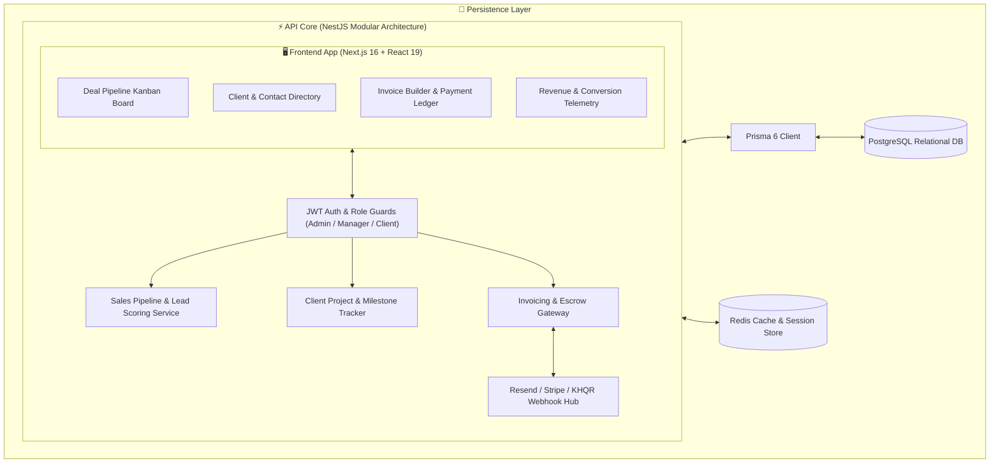
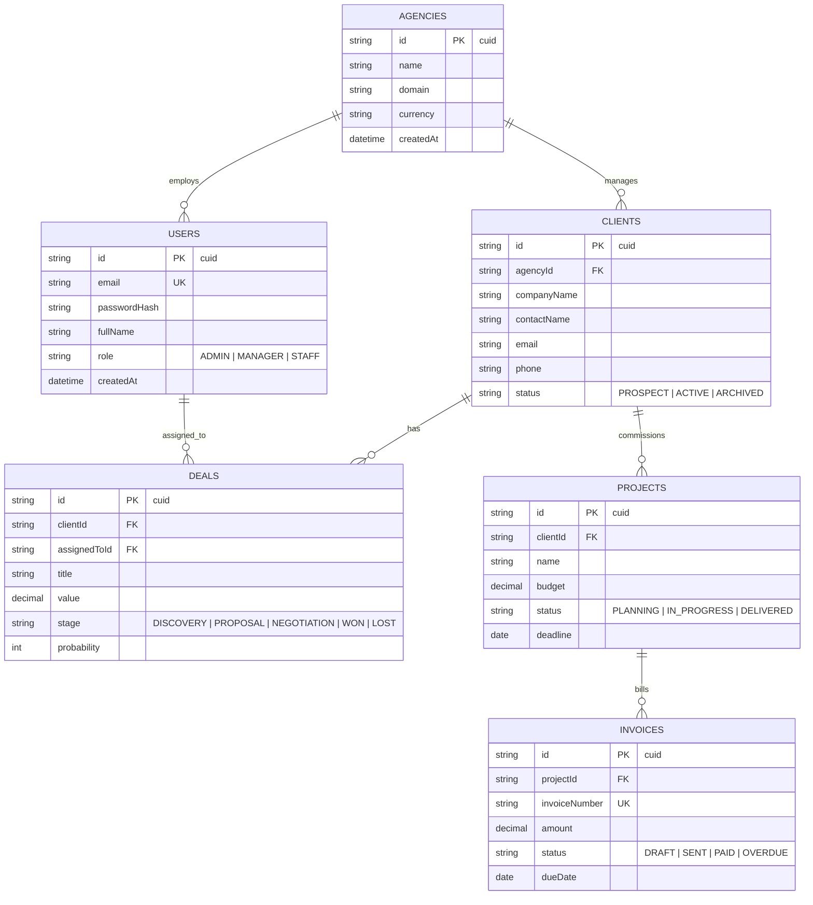
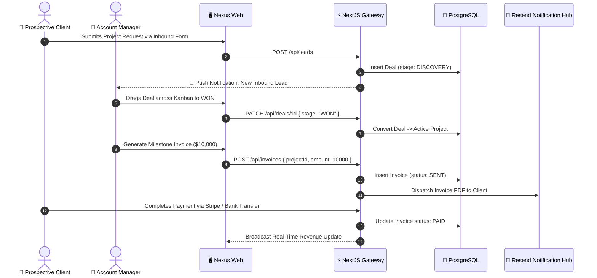

# 🏛️ Nexus — High-Impact Agency Operations CRM & Pipeline Engine

<div align="center">


**Modern, responsive CRM and operational control system engineered for design agencies, development studios, and client-facing consultancies.**

[System Architecture](#-system-architecture) • [Database ERD](#-database-erd) • [Pipeline Sequence](#-agency-deal-to-invoice-lifecycle) • [Quick Start](#-quick-start)

</div>

---

## ⚡ Overview

**Nexus** consolidates lead qualification, sales pipelines, client milestone tracking, and invoicing into a unified, high-performance operational cockpit. Built with a modular NestJS core and a responsive Next.js frontend, Nexus delivers sub-100ms dashboard interactions and full financial transparency.

---

## 🏗️ System Architecture



---

## 📊 Database ERD



---

## 🔄 Agency Deal to Invoice Lifecycle



---

## 🚀 Quick Start

### 1. Install Dependencies
```bash
pnpm install
```

### 2. Configure Environment
```bash
cp .env.example .env
# Set DATABASE_URL, JWT_SECRET, RESEND_API_KEY
```

### 3. Migrate Database & Start Server
```bash
pnpm prisma db push
pnpm run dev
```

Visit `http://localhost:3000` to launch Nexus.

---

## 📄 License
MIT License © **[Ros Rendo](https://github.com/RosRendo)**
